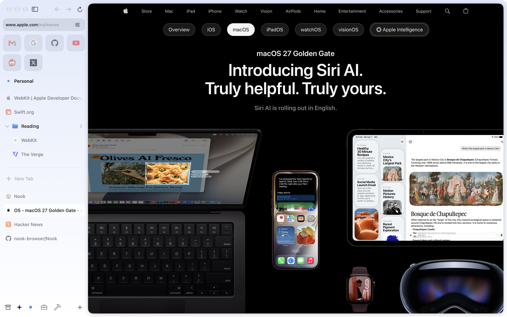

<div align="center">
  
  <h1><b>Nook</b></h1>
  <p>
    A fast, minimal browser with a sidebar-first design for macOS.
    <br>
  </p>
</div>

<p align="center">
  <a href="https://www.apple.com/macos/"></a>
  <a href="https://swift.org/"></a>
  <a href="./LICENSE"></a>
  <a href="https://github.com/nook-browser/Nook/pulls"></a>
  <a href="https://github.com/nook-browser/Nook/issues"></a>
  <a href="https://github.com/nook-browser/Nook/graphs/contributors"></a>
</p>


<p align="center">
  <a href="https://github.com/nook-browser/Nook/releases/latest"></a>
</p>

<p align="center">
  <a href="https://github.com/nook-browser/Nook/releases/latest"></a>
</p>

> **Status:** Development started back up in September 2026 under a new maintainer. See [Releases](https://github.com/nook-browser/Nook/releases) for the current download.

## Features  

-  **Sidebar-first navigation** – vertical tabs that feel natural and uncluttered.
-  **Performance** – optimized with modern macOS APIs for speed and low memory use.  
-  **Minimal, modern UI** – focused on content, not chrome.  

<p align="center">
  <picture>
    <source media="(prefers-color-scheme: dark)" srcset="assets/screenshot-dark.png">
    
  </picture>
</p>


## Getting Started  

### Download
[](https://github.com/nook-browser/Nook/releases/latest)

### or, Build from Source

#### Prerequisites  
- macOS 15.6 (Sequoia) or later, Apple Silicon. Xcode 26 needs 15.6; the built app runs on 15.5 and later
- On-device AI chat and Tab Organizer require macOS 26 or later with Apple Intelligence enabled
- [Xcode](https://developer.apple.com/xcode/) 26 or later, with the Metal Toolchain component (Xcode 26 no longer bundles it)
```bash
git clone https://github.com/nook-browser/Nook.git
cd Nook
xcodebuild -downloadComponent MetalToolchain
open Nook.xcodeproj
```

Nook builds for Apple Silicon only: the bundled adblock-rust framework ships an arm64 slice and nothing else. Xcode resolves the Swift packages on open.

You’ll need to set your personal Development Team in Signing to build locally.

## Project Structure

```
Nook/
├── App/                       # Entry point, AppDelegate, window scene, menu commands
├── Packages/                  # Local Swift packages shared with the planned iOS port
│   ├── NookTabsCore/          # Tab tree model: spaces, items, ordering, on-disk store
│   ├── NookSettings/          # Settings service and every persisted value type
│   ├── NookDesign/            # Design tokens: radii, spacing, type, motion, surfaces
│   ├── NookBlocker/           # Content blocker: filter lists, adblock-rust conversion, cosmetic engine
│   ├── NookTweaks/            # Site tweaks: YouTube, Facebook, social downloads, SponsorBlock, routing
│   ├── NookWeb/               # Tabs controller, page sessions, windows, history, favicons, search
│   └── NookUI/                # Shared SwiftUI: rows, context menus, spaces list, toasts, settings tabs
├── Nook/
│   ├── Managers/              # Feature managers (macOS side)
│   │   ├── BrowserManager/    # Central coordinator; conforms to the package seams
│   │   ├── ExtensionManager/  # WKWebExtension support
│   │   ├── AIManager/         # AI chat providers, MCP client, browser tools
│   │   ├── DevMCPServer/      # Local MCP server for driving the app from a coding agent
│   │   ├── TabOrganizerManager/ # On-device tab grouping with Apple Intelligence
│   │   ├── WebViewCoordinator/  # Web view pool for multi-window display
│   │   ├── DownloadManager/   # File downloads
│   │   ├── DialogManager/     # Modal dialogs
│   │   ├── PeekManager/       # Quick preview overlay
│   │   ├── SplitViewManager/  # Split-screen tab viewing
│   │   └── ...
│   ├── Models/                # macOS-only models and SwiftData entities
│   ├── Components/            # SwiftUI views: sidebar, website view, settings, drag and drop, dialogs
│   ├── Browser/               # macOS-only slice of the tab controller
│   ├── Utils/                 # WebKit helpers and utilities
│   └── ThirdParty/            # adblock-rust FFI crate and other embedded dependencies
├── CommandPalette/            # Command palette UI
├── Navigation/                # Sidebar structure: header, bottom bar, spaces list
├── Onboarding/                # First-run flow
├── NookiOS/                   # iOS app target, not released yet
├── UI/                        # Shared buttons and controls
├── docs/                      # Ad blocker architecture notes
├── scripts/                   # Filter list refresh, scriptlet and redirect generators, checks
└── assets/                    # Static assets
```

### Architecture Overview

Nook follows a manager-based architecture where:
- **Managers** handle business logic and coordinate between different parts of the app
- **Models** represent data and state using Swift's `@Observable` macro
- **Components** are SwiftUI views that reactively update based on model changes
- **BrowserManager** acts as the central coordinator, connecting all managers together
- **Packages** hold the model, blocker, tweak and shared view code that has no AppKit dependency, so it can be reused by an iOS app


---

<div align="center">

## Star History

<a href="https://www.star-history.com/#nook-browser/nook&type=date&legend=bottom-right">
 <picture>
   <source media="(prefers-color-scheme: dark)" srcset="https://api.star-history.com/svg?repos=nook-browser/nook&type=date&theme=dark&legend=bottom-right" />
   <source media="(prefers-color-scheme: light)" srcset="https://api.star-history.com/svg?repos=nook-browser/nook&type=date&legend=bottom-right" />
   
 </picture>
</a>

</div>

---

### LICENSES
With the exception of third-party libraries in Nook/ThirdParty, all code is under the GPL 3.0 License. The relevant third-party code is licensed per-folder under a variety of free, open-source software licenses.
